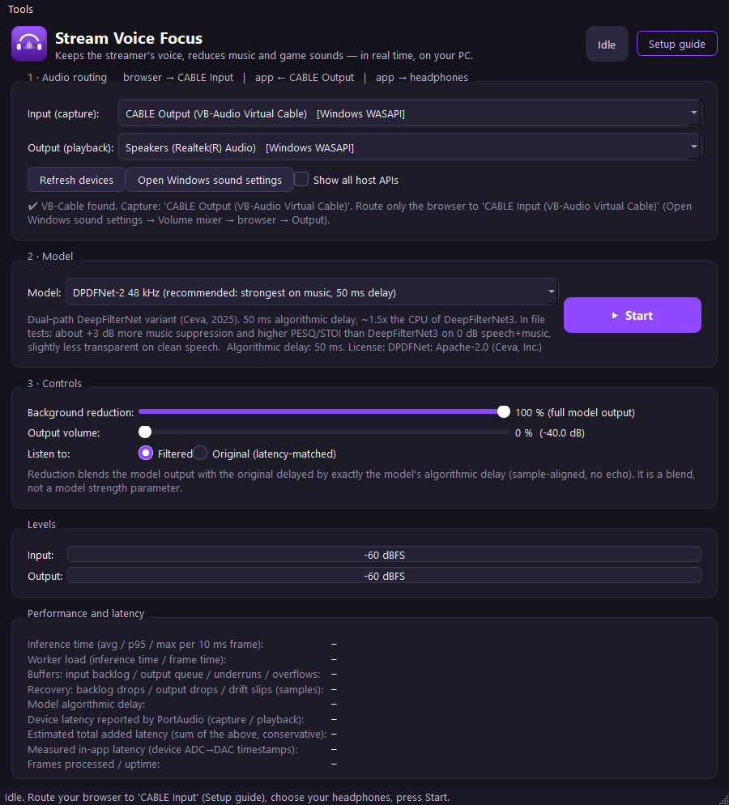
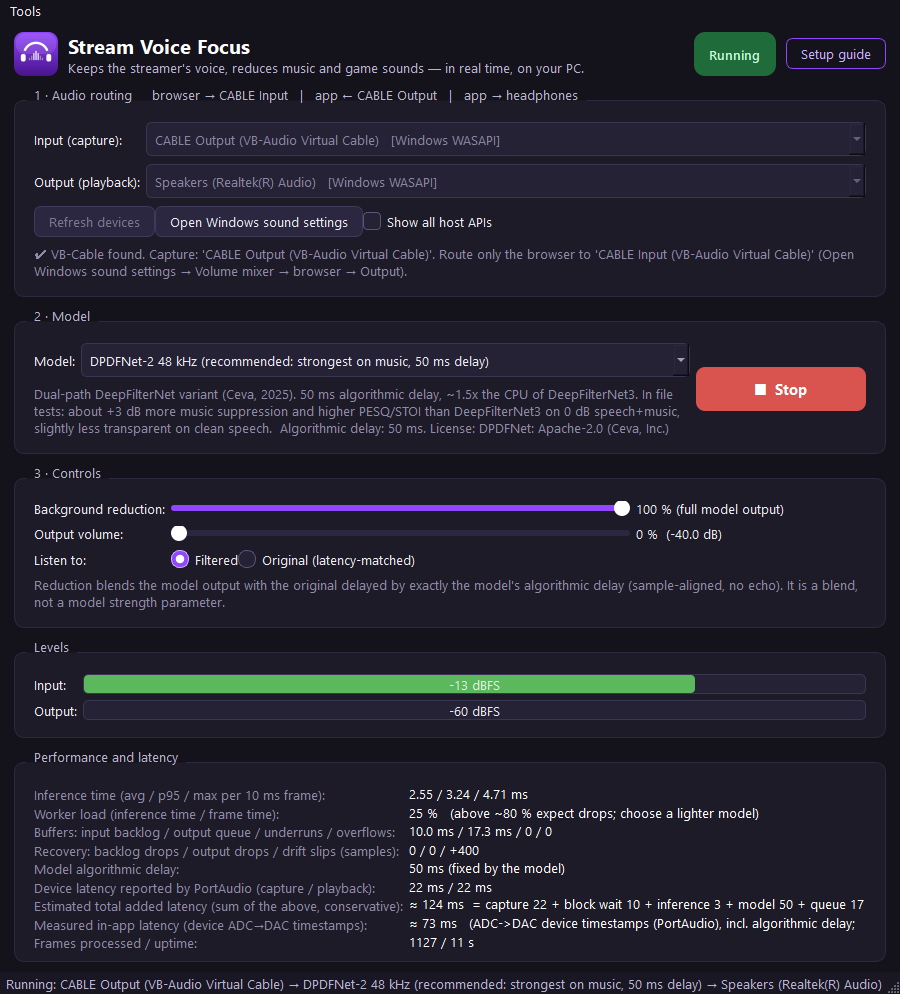

# Stream Voice Focus

<p align="center"></p>

Real-time speech enhancement for browser (Twitch) audio on Windows. The browser plays into a
virtual cable, this app captures the cable, runs a streaming speech-enhancement network, and
plays the cleaned audio to your headphones.

## Download (no coding needed)

1. Go to the **[Releases page](https://github.com/Roy-Mutwiri/Sound-Twitch-Filter/releases/latest)** and
   download **`StreamVoiceFocus-Setup-0.1.0.exe`**. Run it: it installs the app with a Start-menu and
   desktop shortcut (no Python, no extra downloads except the free VB-Cable driver and the speech model).
   If you prefer no installer, download `StreamVoiceFocus-0.1.0-portable.zip`, unzip anywhere and run
   `StreamVoiceFocus.exe`.
2. Install **VB-Cable** (free) from the official site https://vb-audio.com/Cable/ — run its installer
   *as administrator* and reboot. The app detects it and shows a link if it is missing; it never installs
   drivers by itself.
3. Open Windows Settings → System → Sound → **Volume mixer**, find your browser and set its **Output** to
   **CABLE Input (VB-Audio Virtual Cable)**. Reload the Twitch tab.
4. Start **Stream Voice Focus**, choose your **headphones** as Output, press **Start**. The first Start
   downloads the speech model (about 30 MB, once); afterwards everything runs offline on your CPU.

The in-app **Setup guide** button repeats these steps with one-click shortcuts to the Windows sound settings
and the VB-Cable page. Windows SmartScreen may warn about an unsigned app on first launch: choose
"More info → Run anyway".

| Idle | Running |
|---|---|
|  |  |

```
Browser (Twitch)  ──► CABLE Input (VB-Cable playback endpoint)
                              │
Stream Voice Focus ◄── CABLE Output (VB-Cable recording endpoint)
        │  model (DPDFNet-2 / DeepFilterNet3 / RNNoise), 10 ms frames
        └──► your headphones / speakers
```

**What it does:** reduces music, game effects and ambient noise around the streamer's voice using
actual neural speech enhancement (not an EQ, gate or volume trick). The original voice, language
and timing are preserved: nothing is transcribed or re-synthesised.

**What it does not do:** it does not isolate one particular speaker. Other voices (teammates,
game dialogue, singing) are speech to the model and are kept, and overlapping voices can come
out distorted. Separation is never perfect: loud, speech-like or tonal effects leak through.
Because the audio is filtered separately from the video, the sound will lag slightly behind
the Twitch picture (see "Latency").

---

## 1. Requirements

* Windows 10/11, x64. Tested on Windows 11 Pro 26200, Ryzen 9 7950X, 64 GB RAM.
* Python 3.11 (the `deepfilterlib` wheel only exists for 3.11; 3.12/3.14 will not work for the
  DeepFilterNet backend). The exe build needs no Python.
* [VB-Audio Virtual Cable](https://vb-audio.com/Cable/) (free, donationware). Install it from the
  official site as administrator and reboot. This app only detects it; it never installs drivers.
* No GPU needed. All models run on one CPU core with large headroom (see "Performance").

## 2. Install and run (source)

```
install.bat      REM creates .venv (Python 3.11), installs pinned requirements, exports the DFN3 ONNX graph
run_app.bat      REM starts the desktop app
```

Models download once on first use (DeepFilterNet3 checkpoint ~ 9 MB from GitHub; DPDFNet weights
from Hugging Face, ~ 30 MB) and are cached under `%LOCALAPPDATA%`. After that everything runs offline.

Packaged build: `build_exe.bat` produces `dist\StreamVoiceFocus\StreamVoiceFocus.exe` (PyTorch is
excluded; the exe ships the exported ONNX graph and the icon). `build_installer.bat` then wraps it into
`installer_out\StreamVoiceFocus-Setup-<version>.exe` with Inno Setup 6 (`winget install JRSoftware.InnoSetup`).
Both artefacts are attached to each GitHub release.

## 3. Routing setup (exact steps)

1. Install VB-Cable and reboot. In this app the "Audio routing" box must say "VB-Cable found".
2. Route **only the browser** to the cable:
   *Windows Settings → System → Sound → Volume mixer* (Windows 11) or
   *Settings → System → Sound → App volume and device preferences* (Windows 10).
   Find your browser (e.g. Chrome/Firefox/Edge) and set its **Output** to
   **"CABLE Input (VB-Audio Virtual Cable)"**. Leave the system default output as your headphones.
   The browser may need to be restarted or the tab reloaded for the change to take effect.
   Note: this routes *every tab* of that browser (YouTube, Discord-in-browser, ...) through the app.
   Use a second browser or profile for things you do not want processed.
3. In Stream Voice Focus:
   * Input (capture): **CABLE Output (VB-Audio Virtual Cable)** (selected automatically when found)
   * Output (playback): your **headphones** (never a CABLE/Voicemeeter endpoint)
   * Model: *DPDFNet-2 48 kHz* (default) or *DeepFilterNet3* for lowest delay
   * Press **Start**.
4. Play a Twitch stream. The Input meter must move. Use **Listen to: Original / Filtered** to A/B
   compare; both are time-aligned so switching does not jump.

Do not set CABLE Input as the Windows *default* output device, or every app (including this one,
if you select it by mistake) would play into the cable. The app refuses the one combination that
is a guaranteed feedback loop (input CABLE Output + output CABLE Input) and warns about other
virtual outputs and microphone inputs.

**Hearing the original and the filtered audio at the same time** means the browser is still
also playing to the headphones (routing not applied, or a second browser/app is playing the
stream). Check the volume mixer again; only the cable should receive the browser.

## 4. Controls

| Control | Meaning |
|---|---|
| Background reduction | 100 % = pure model output. Lower values blend the model output with the original signal, delayed by exactly the model's algorithmic delay, so there is no echo or comb filtering. This is a blend (DeepFilterNet's own `atten_lim_db` mechanism), not a model-native "strength" parameter; the network always runs at full strength. The label shows the resulting maximum attenuation in dB. |
| Output volume | 0–150 %, smoothed per sample. A soft limiter (knee at −0.9 dBFS) prevents clipping. |
| Listen to | Filtered / Original. The original path is latency-matched and the switch is a 10 ms crossfade. |
| Model | See section 5. Changing it takes effect on the next Start. |
| Refresh devices | Re-enumerates endpoints (e.g. after plugging in headphones). |

Settings (devices by host-API + endpoint name, model, sliders) persist in
`%APPDATA%\StreamVoiceFocus\settings.json`. If a saved device is missing at start-up, the app asks
you to choose a replacement instead of silently picking another endpoint.

## 5. Models

All backends are true frame-by-frame streaming implementations: 480-sample (10 ms) frames at
48 kHz with all network and STFT state carried between frames. Output is identical to
processing the whole file at once (verified in `tests/test_models.py`).

| Key | Model | Algorithmic delay | CPU per 10 ms frame (1 thread, 7950X) | License |
|---|---|---|---|---|
| `dpdfnet2_48k` (default) | DPDFNet-2 48 kHz HR (Ceva, 2025), via `dpdfnet` package / ONNX Runtime | 50 ms | ~2.1 ms (p95 ~2.5) | Apache-2.0 |
| `dpdfnet8_48k` | DPDFNet-8 48 kHz HR | 50 ms | ~4.7–5.6 ms (p95 ~5.6–8) | Apache-2.0 |
| `dfn3` | DeepFilterNet3 (official checkpoint), streaming graph exported to ONNX Runtime | 30 ms | ~1.2–1.6 ms (p95 ~2.3) | MIT / Apache-2.0 |
| `dfn3_torch` | same model, PyTorch eager runtime (fallback if the ONNX export is missing) | 30 ms | ~5 ms (p95 ~6) | MIT / Apache-2.0 |
| `rnnoise` | RNNoise (xiph), via `pyrnnoise` | 20 ms | ~0.5 ms | BSD-3 |
| `passthrough` | no processing (routing/latency tests) | 0 | 0 | – |

Why these: DeepFilterNet3 was the planned primary model (best-known open full-band streaming
enhancer, 10 ms hop, 2-frame lookahead). The pip package only provides offline inference, so the
app vendors the community pure-PyTorch streaming port (`stream_voice_focus/models/_torchdf_minimal.py`,
from the DeepFilterNet repository fork branch `torchDF_main`), fixes its FFT for export, and runs
the exported graph in ONNX Runtime (bit-identical to PyTorch, 3× faster). During model research
DPDFNet (Dec 2025, Apache-2.0, maintained, 48 kHz, stateful ONNX streaming API) turned out to be
measurably stronger on music mixtures at the same frame size, so it became the default; DFN3
remains the lowest-delay, most transparent option. Models evaluated and rejected: GTCRN/DTLN
(16 kHz, weaker), Facebook denoiser (CC-BY-NC, archived), MossFormer2/ClearerVoice (offline only).
A multi-second offline separator was not added: no quality mode in this app exceeds 50 ms.

### Quality results (file test mode, `tools/eval_quality.py`)

Objective metrics on 12 s mixtures built from licensed material (LibriSpeech CC-BY 4.0 speech,
CC-BY music from the librosa example set, synthetic gunshot/explosion bursts). PESQ-WB/STOI/SI-SDR
are intrusive (against the clean speech we mixed in); DNSMOS is Microsoft's non-intrusive P.835
model (SIG/BAK/OVRL, MIT). Higher is better everywhere except "residual".

| Case | Input | DFN3 | DPDFNet-2 | DPDFNet-8 | RNNoise |
|---|---|---|---|---|---|
| Speech + drum&bass, 0 dB SNR: SI-SDR gain / PESQ / STOI / BAK | – / 1.08 / 0.81 / 1.44 | +5.4 dB / 1.09 / 0.83 / 3.31 | **+8.2 dB / 1.76 / 0.91 / 3.43** | +9.2 dB / 1.89 / 0.93 / 3.21 | +3.4 dB / 1.41 / 0.87 / 3.03 |
| Speech + orchestra, 0 dB | – / 1.26 / 0.78 / 1.63 | +4.5 / 1.34 / 0.85 / 3.41 | **+7.2 / 1.85 / 0.92 / 3.85** | +8.3 / 2.11 / 0.94 / 3.76 | +2.4 / 1.28 / 0.82 / 3.54 |
| Speech + drum&bass, 5 dB | – / 1.10 / 0.88 / 1.50 | +2.3 / 1.12 / 0.86 / 3.51 | **+5.3 / 2.00 / 0.94 / 3.11** | +5.9 / 2.19 / 0.95 / 3.27 | +1.4 / 1.11 / 0.90 / 3.24 |
| Speech + gunshots/explosions, 0 dB | – / 1.12 / 0.84 / 2.68 | +11.3 / 2.48 / 0.93 / 3.60 | +11.4 / 2.57 / 0.94 / 3.63 | +11.9 / 2.50 / 0.94 / 3.54 | +7.4 / 1.17 / 0.91 / 3.93 |
| Speech + gunshots, −5 dB | – / 1.10 / 0.79 / 2.51 | +14.1 / 2.09 / 0.90 / 3.84 | +15.2 / 2.33 / 0.93 / 3.71 | +16.1 / 2.21 / 0.93 / 3.54 | +11.2 / 1.15 / 0.90 / 4.07 |
| Clean speech (transparency): SI-SDR / PESQ | ∞ / 4.64 | **30.4 dB / 4.38** | 15.3 dB / 3.74 | 15.5 dB / 3.57 | 10.8 dB / 2.66 |
| Music only, no speech: residual level | 0 dB | −37.8 dB | −93.7 dB | −96.6 dB | −24.0 dB |
| Effects only, no speech: residual level | 0 dB | −41.3 dB | −96.3 dB | −91.6 dB | −78.1 dB |
| Two talkers, 0 dB (vs. the sum of both): SI-SDR / PESQ / STOI | ∞ / 4.64 / 1.00 | 3.7 dB / 1.48 / 0.75 | 2.2 dB / 1.29 / 0.76 | 4.0 dB / 1.38 / 0.83 | 5.0 dB / 1.45 / 0.81 |

Reading: on music at 0 dB DPDFNet-2 gains about 3 dB more SI-SDR and 0.5–0.7 PESQ over DFN3 at
+20 ms delay and ~1.5× CPU; DPDFNet-8 adds a little more for ~3× the CPU. DFN3 is the most
transparent on clean speech. Impulsive effects are suppressed well by all three deep models.
All models distort overlapping voices (low PESQ against the two-talker reference): that is a
known limitation, not a feature. RNNoise is much weaker on music.

**These are measurements, not listening tests.** The development environment had no way to
listen; loudness-matched before/after files are in `samples/out/` (`<case>_input.wav` vs
`<case>_<model>.wav`) so you can judge intelligibility, missing syllables, metallic artefacts,
pumping and remaining effects yourself. A real Twitch recording would be a better test than
these synthetic mixtures: see "What needs you".

## 6. Latency

The app reports these separately (never labelling inference time as total latency):

| Component | DFN3 | DPDFNet-2 | How obtained |
|---|---|---|---|
| Model algorithmic delay | 30 ms | 50 ms | fixed; measured with an impulse and cross-correlation |
| Inference execution | ~1.5–2.5 ms avg, p95 < 4 ms | ~2–2.5 ms avg | measured per frame while running |
| Capture block wait | 10 ms | 10 ms | one 480-sample block must arrive before processing |
| Output queue (jitter buffer) | ~15–20 ms | same | measured ring fill, target 20 ms |
| Device latency reported by PortAudio | 22 ms capture + 22 ms playback | same | WASAPI shared mode, as reported |
| **Estimated total added latency** (sum, conservative) | **≈ 100 ms** | **≈ 120 ms** | shown in the UI |
| **Measured in-app latency** (ADC→DAC device timestamps) | **≈ 52–55 ms** | ≈ 75 ms | shown in the UI when timestamps are valid |

The estimate is an upper bound (PortAudio's reported 22 ms per side appears to include buffering
that the timestamp measurement shows is not all incurred). An external acoustic/electrical
measurement was **not** possible on this machine: it needs a second loopback path (a second
virtual cable or Voicemeeter running). `tools/measure_latency_loopback.py` performs that
measurement when such a path exists. Bluetooth headphones add their own 100–250 ms on top of
everything here, which the app can neither measure nor avoid.

Target was < 200 ms added latency; the app achieves that with margin on this machine, but it
is a target, not a guarantee: a slower CPU, a heavy game, or a Bluetooth stack can change it.
The video will run ahead of the filtered audio by the total added latency. There is no way to
delay only the Twitch video from outside the browser; if lip-sync matters, prefer the DFN3
model (lowest delay) and wired headphones.

## 7. Performance notes

* All models fit comfortably on one CPU thread (worker load 12–25 % for DPDFNet-2/DFN3 in the
  UI's "Worker load" row; above ~80 % audio starts to be dropped). GPU was not used: the per-frame
  cost is already far below real time and a GPU round-trip per 10 ms frame would add latency
  rather than remove it. The RTX 5060 Ti (sm_120) would also need a CUDA 12.8+ PyTorch build.
* Bounded buffers: 1 s rings; if inference falls behind, the oldest backlog (> 80 ms) is dropped
  with a short fade and counted ("backlog drops"); delay can never grow unbounded.
* Clock drift between the capture and playback devices is corrected with ±1–2 sample resamples
  per frame ("drift slips"), and underruns are filled with faded silence.

## 8. Troubleshooting

| Symptom | Likely cause / fix |
|---|---|
| Input meter stays at −60 dBFS | The browser is not routed to CABLE Input, the tab is muted, or the stream is paused. Reload the tab after changing the volume mixer. |
| Silence on output but input moves | Wrong output device (e.g. Bluetooth headset in "Hands-Free" mode, or the monitor). Pick the "Headphones"/"Speakers" endpoint. Check Output volume. |
| Hearing original + filtered together | Browser still plays to the headphones directly, or another app plays the same stream. Fix the volume mixer; only one path should play. |
| Echo / doubled voice with Bluetooth | Headset in Hands-Free (HFP) mode: choose the "Headphones (…)" A2DP endpoint, not "Headset (…)". |
| Crackling, dropouts | "underruns" or "backlog drops" rising: CPU too busy (choose DFN3 or RNNoise), another app in exclusive mode, Bluetooth interference, or power-saving CPU states. Close other audio apps; try the "Speakers" endpoint. |
| Audio/video delay | Inherent (see "Latency"). Use DFN3 and wired headphones for the smallest delay. |
| "Feedback loop" error on Start | Output is CABLE Input. Choose headphones. |
| Device disappeared | The engine stops and reports it; press Refresh devices and Start again. |
| Model fails to download | First run needs internet for the weights; afterwards it is offline. Check `%LOCALAPPDATA%\dpdfnet\models` and `%LOCALAPPDATA%\DeepFilterNet`. |

## 9. Testing

```
.venv\Scripts\python.exe -m pytest tests          REM unit + simulated-device tests (~40 s)
.venv\Scripts\python.exe tools\engine_smoke.py --seconds 60 --model dpdfnet2_48k --file samples\out\music_dnb_0dB_input.wav
.venv\Scripts\python.exe tools\eval_quality.py    REM rebuild the quality table (needs samples\raw)
.venv\Scripts\python.exe -m stream_voice_focus.file_mode in.wav out.wav --model dfn3
```

`tools/engine_smoke.py` plays a file into CABLE Input (like the browser) and runs the engine on
real devices with the output at 0 % volume (silent), printing stats every second.

Sustained run on this machine (2026-10-10, DPDFNet-2, speech+music file looped into CABLE Input,
CABLE Output → engine → Realtek speakers at 0 %): **600 s, 60,043 frames, 0 backlog drops,
0 output drops, 0 overflows, 3 underruns** (two of them while a PyInstaller build and the test
suite ran on the same machine), inference 2.4 ms avg / 3.1 ms p95 / 41 ms worst single frame,
measured in-app latency ≈ 80 ms, summed estimate ≈ 131 ms. `tests/` covers
the ring buffer (bounds, SPSC ordering), model delays and state, the feedback/routing checks,
and the engine with simulated streams (bounded overload recovery, latency-matched bypass without
discontinuity, ±0.3 % clock drift, stop/start cycles, device-loss events).

## 10. Project layout

```
stream_voice_focus/   package: engine.py (real-time), devices.py, ringbuffer.py, resampler.py,
                      settings.py, file_mode.py, models/ (dfn3, dpdfnet, rnnoise, registry), ui/
tools/                export_onnx.py, engine_smoke.py, eval_quality.py, model_sanity.py,
                      measure_latency_loopback.py, align_test.py
tests/                pytest suite
samples/raw           licensed test material (CMU Arctic, LibriSpeech, librosa examples)
samples/out           evaluation mixtures and processed outputs
models_cache/         exported dfn3_stream.onnx, DNSMOS model
```

## 11. Licenses

App code: MIT. DeepFilterNet (MIT/Apache-2.0), torchDF streaming port (same repository),
DPDFNet (Apache-2.0), RNNoise (BSD-3) + pyrnnoise (Apache-2.0), ONNX Runtime (MIT), PySide6
(LGPL-3), PortAudio/sounddevice (MIT), libsoxr (LGPL-2.1), DNSMOS (MIT, evaluation only).
Test audio: CMU Arctic (free for any use), LibriSpeech (CC-BY 4.0), librosa examples (CC-BY/CC0).
